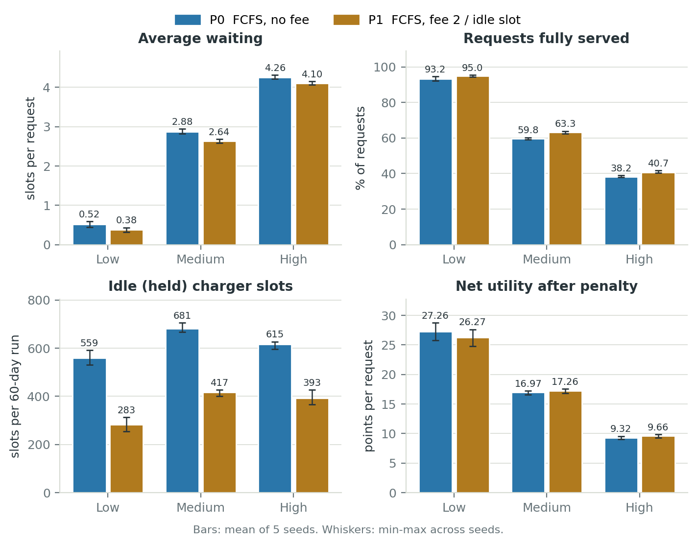
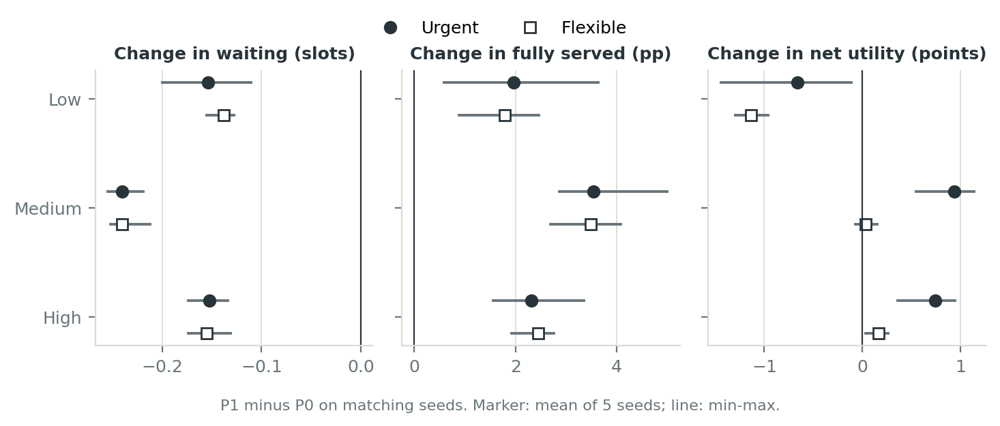
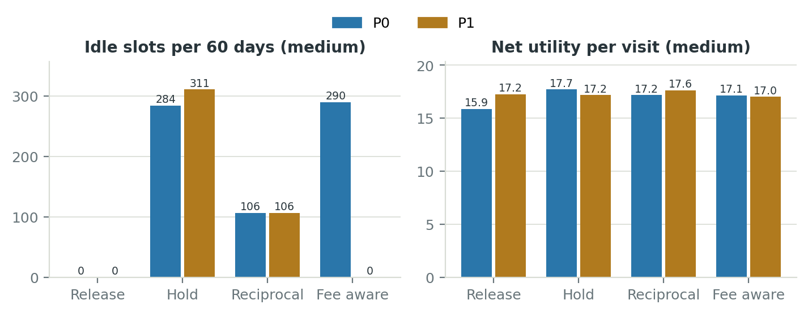
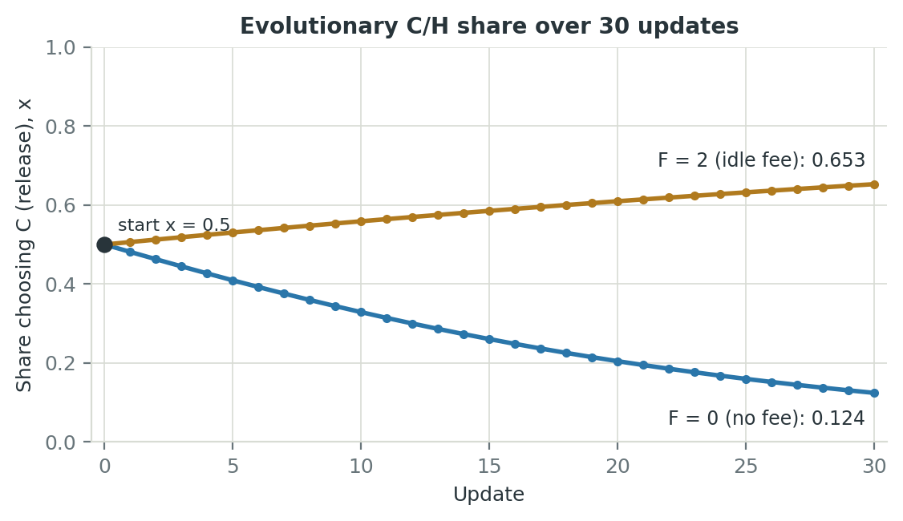
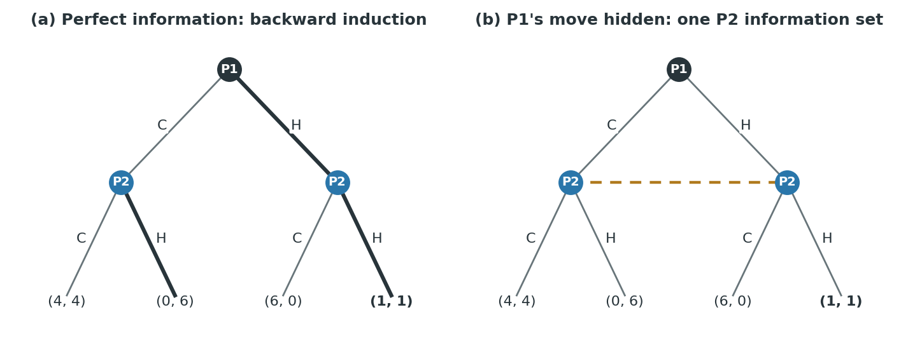
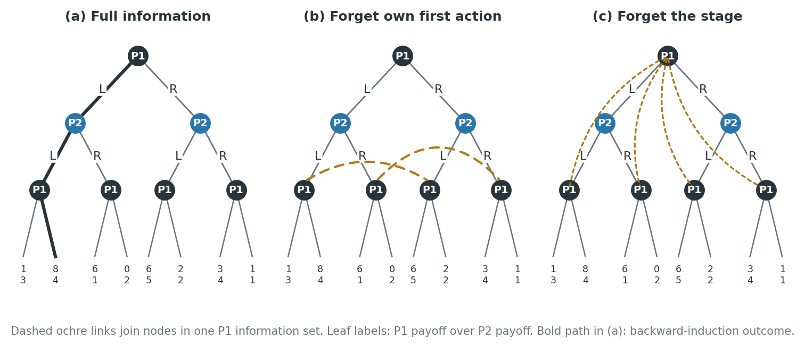

# 1. Problem

A shared electric-vehicle (EV) charger serves one car at a time. When a car finishes charging, its owner can release the bay or leave the car connected. Leaving it is convenient for the owner and costly for whoever is queuing, because a full car that is still connected blocks a charger. Charging networks respond with idle fees; Electrify America, for example, states that "idle fees may be imposed for parking time after your charging session has ended" [1]. The same behaviour appears in measured data: at the JPL workplace site described by Lee, Li and Low, demand was high enough that drivers ran an informal programme to "move their EVs after they have finished charging to free up plugs for other drivers" [3]. A fee is not neutral, however. Drivers differ in how much they need energy, how much they dislike waiting and how much they gain from leaving the car, so a rule that shortens the average queue may still make some drivers worse off.

**Research question.** Does an idle penalty reduce waiting, and how does it affect drivers with different needs? We compare policy P0 (first come, first served, no fee) with P1 (the same queue order and a fee of 2 points per idle slot) in a small synthetic system, and explain the driver choice with game theory.

**Reading.** Shoham and Leyton-Brown [2] supply the theory: normal-form games and Nash equilibrium (Ch. 3), extensive form, information and recall, and mixed versus behavioral strategies (Ch. 5), repeated games (Sec. 6.1), Bayesian games (Sec. 6.3) and evolutionary learning (Sec. 7.7). *Research paper note on Lee, Li and Low (2019) [3].* The problem they address is that researchers lacked real EV charging data to evaluate scheduling algorithms and study driver behaviour, so they released ACN-Data: over 30,000 sessions from the Caltech garage (54 stations plus a 50 kW DC fast charger, open to the public) and JPL (52 stations, employees only). The players are drivers, who choose when to arrive and leave and may enter an estimated departure time and energy request in a mobile app, and the site operator, whose adaptive scheduler sets charging rates under shared capacity. The data record connection, last charging and disconnection times separately, so time spent connected after charging can be measured. User estimates were often unreliable, "partially because of a lack of incentives", and when Caltech introduced a $0.12/kWh fee on 1 November 2018, sessions and delivered energy fell noticeably. One difference from our project: ACN-Data does not reveal driver urgency, private utility or why a car stayed connected, so we assume those values and isolate one strategic choice: release or hold. Evolutionary games have also been applied to shared charging; Xu et al. [4] study a tripartite game with government involvement in sharing charging facilities among EV logistics firms, a different set of players from ours.

# 2. Assumptions

* **Site and time.** One site with six identical 6 kW chargers; 16 half-hour slots per day (boundaries 0–16 = 08:00–16:00); each charger delivers up to 3 kWh per full slot; 40 recurring drivers; 60 simulated days per run.
* **Data.** Only the supplied synthetic archive is used. Five input sets were generated with the supplied script (`--seed 0..4 --urgent-prior 0.30`) into separate folders; the original files were never modified and pass their checksums. Each set has 4,320 requests (720 low, 1,440 medium and 2,160 high demand). Site capacity is 288 kWh per day, while requests average 145, 290 and 433 kWh per day, so medium demand is at capacity and high demand exceeds it. The seeds contain 12, 11, 15, 10 and 6 Urgent drivers.
* **Utility.** *U = v·kWh − w·waiting slots + h·idle slots − F·idle slots*, with Urgent (v, w, h) = (3, 3, 1) and Flexible (2, 1, 2). Waiting ends when charging starts; a driver who is never served waits from arrival to departure. F = 0 under P0 and 2 under P1. Values are teaching points, not prices, and the penalty is counted as a loss to the driver.
* **Driver rules.** Each driver follows its supplied rule after a full charge. **Release** always releases. **Hold** takes the largest legal hold, up to two slots. **Reciprocal** releases on its first visit, then releases only if its last visit was fully served with at most two waiting slots, otherwise it holds one slot. **Fee aware** chooses the legal O that maximises (h − F)·O, with ties going to release, so under P1 all Fee aware drivers release (h − F = −1 for Urgent, 0 for Flexible). The rules are programmed behaviour, not computed equilibria, and arrivals and requests do not react to the fee.
* **Information.** A rule sees only its own driver's row, its own last visit and public information (time, fee, queue length, legal holds), never other drivers' types, rules or future arrivals.

# 3. Design

**Simulator.** The Python simulator (`shared_charge/simulator.py`) processes each day boundary by boundary in the brief's order: (1) add energy delivered in the previous slot; (2) remove drivers whose departure time has arrived, including incomplete and unserved ones; (3) take one Release / Hold 1 / Hold 2 decision from each newly completed driver who can stay; (4) end holds that expire; (5) add arrivals; (6) assign free chargers by arrival time, then driver ID; (7) charge during the next slot. A hold is legal only if it ends by departure, so a car completing exactly at departure is released automatically. Gross utility, penalty and net utility are saved separately for every visit, with `NA` where service never started or finished. The simulator has no randomness, so identical inputs give identical results.

**Checks.** Before any experiment, the simulator reproduced the supplied one-charger mini case exactly, per driver: starts 0, 2, 3 with total wait 4, energy 15 kWh and utility 25; and starts 0, 3, 4 with wait 6 and utility 23 when A holds one slot. 71 automated tests cover queue order, hold legality and expiry, unserved waiting cost, Reciprocal memory, the privacy of rule inputs, no double occupancy of a charger, energy only while charging, every game calculation and the saved results.

**Experiments.** 2 policies × 3 demand levels × 5 seeds = **30 runs** of 60 days. Within a seed, P0 and P1 use identical requests, types and rules, so the fee is the only difference; queues reset daily and all state resets between runs. A control experiment forces every driver to the fixed Hold rule at medium demand for both policies and all five seeds (**10 runs**). Results are compared seed by seed (P1 − P0), then summarised as the mean change and its range. A local results screen shows the runs and the evolutionary graph.

**Game-theory model.** The teaching C/H game (Table 1) captures the release-or-hold choice; C is release and H is hold one slot. It is used for the written analysis (normal and extensive form, information and recall, mixed and behavioral strategies, repetition, a Bayesian game) and for a one-population evolutionary model. Calculations and diagrams are in Appendix A.

**Table 1. Shared-use C/H game (payoffs: P1, P2; no fee).**

| | P2 C | P2 H |
|---|---|---|
| **P1 C** | 4, 4 | 0, 6 |
| **P1 H** | 6, 0 | **1, 1** |

# 4. Findings

## 4.1 Waiting, Service and Idle Use

The fee lowered average waiting and raised the share of fully served requests **in all 15 matched seed comparisons** (Figure 1, Table 2). Mean waiting fell from 15.6 to 11.4 minutes at low demand, 86.3 to 79.1 at medium and 127.7 to 123.0 at high. Delivered energy rose by 78, 518 and 614 kWh per run, and the number of drivers who never reached a charger fell from 5.6 to 3.8, 197 to 166 and 627 to 583. Idle slots fell by 49%, 39% and 36%, but not to zero: only the Fee aware rule responds to the fee (its 280–290 idle slots per run fall to none), while Hold drivers keep holding and Reciprocal holds depend only on each driver's last visit.

**Table 2. Mean of five seeds, with the P1 − P0 change and its range across seeds.**

| Demand | Measure | P0 | P1 | Change (range) |
|---|---|---:|---:|---|
| Low | Avg. wait (slots) | 0.52 | 0.38 | −0.14 (−0.16 to −0.12) |
| | Fully served | 93.2% | 95.0% | +1.8 pp (+0.8 to +2.6) |
| | Idle slots / run | 559 | 283 | −276 (−281 to −269) |
| | Net utility / visit | 27.26 | 26.27 | **−0.99 (−1.19 to −0.82)** |
| Medium | Avg. wait (slots) | 2.88 | 2.64 | −0.24 (−0.25 to −0.22) |
| | Fully served | 59.8% | 63.3% | +3.5 pp (+2.9 to +4.3) |
| | Idle slots / run | 681 | 417 | −264 (−281 to −241) |
| | Net utility / visit | 16.97 | 17.26 | +0.30 (+0.21 to +0.37) |
| High | Avg. wait (slots) | 4.26 | 4.10 | −0.16 (−0.17 to −0.13) |
| | Fully served | 38.2% | 40.7% | +2.4 pp (+2.3 to +2.7) |
| | Idle slots / run | 615 | 393 | −222 (−236 to −199) |
| | Net utility / visit | 9.32 | 9.66 | +0.34 (+0.28 to +0.42) |

The matched seeds agree with each other. Table 3 shows medium demand seed by seed: every seed has lower waiting, more drivers fully served and fewer idle slots under P1, and Urgent drivers gain in every seed. The only measure that changes sign between seeds is Flexible net utility, which is slightly negative in seeds 1 and 2 and positive in the other three.

**Table 3. Medium demand, matched seeds (P0 and P1 values; net utility as the P1 − P0 change per visit).**

| Seed | Wait P0 | Wait P1 | Served P0 | Served P1 | Idle P0 | Idle P1 | Urgent net | Flexible net |
|---|---:|---:|---:|---:|---:|---:|---:|---:|
| 0 | 2.94 | 2.69 | 60.3% | 64.0% | 671 | 414 | +1.14 | +0.03 |
| 1 | 2.84 | 2.60 | 59.7% | 62.6% | 686 | 420 | +1.02 | −0.04 |
| 2 | 2.89 | 2.67 | 60.3% | 63.4% | 668 | 427 | +1.07 | −0.07 |
| 3 | 2.82 | 2.58 | 59.6% | 63.9% | 705 | 424 | +0.91 | +0.09 |
| 4 | 2.89 | 2.64 | 59.1% | 62.8% | 673 | 400 | +0.55 | +0.15 |

## 4.2 Who Gains and Who Pays

Both driver types waited less and were fully served more often in every seed, but the net effect depends on type and congestion (Figure 2). **Urgent** drivers gained at medium (+0.94 points per visit, range +0.55 to +1.14) and high demand (+0.75), because their waiting cost is high (w = 3) and their holding benefit small (h = 1). **Flexible** drivers roughly broke even at medium demand (+0.03, range −0.07 to +0.15, better in only 3 of 5 seeds) and gained a little at high demand (+0.17): the fee removes the holding benefit they value most (h = 2), and a shorter queue is worth less to them (w = 1). By rule at medium demand (Figure 3), Release drivers gained most (+1.38 points per visit) from shorter queues they did nothing to create, Reciprocal drivers gained +0.45, Fee aware drivers were roughly unchanged (−0.13: they give up a private holding benefit but wait less) and Hold drivers lost 0.52 because they keep holding and pay the fee.

**When the fee does not help.** At low demand, net utility fell for both types in all five seeds (Urgent −0.66, Flexible −1.13 per visit). The queue is already short, so the time saved (about four minutes) is worth less than the holding benefit given up and the penalties paid; even gross utility fell slightly (−146 points per run), while it rose by 1,262 and 1,514 points per run at medium and high demand. **Control:** with every driver on fixed Hold, P0 and P1 produced identical schedules, waits and idle slots in all five seeds; the only change was the penalty (2,093 points per run, −1.45 net utility per visit). A fee works only through drivers who respond to it.

## 4.3 Game-Theory and Evolutionary Results

In the C/H game, H is strictly dominant (6 > 4 and 1 > 0), so the unique Nash equilibrium is (H, H) with (1, 1), although (C, C) gives (4, 4). This is a prisoner's dilemma, the problem an idle fee targets: with a fee of 2, C becomes weakly dominant and (C, C) an equilibrium, which is the Fee aware rule's logic. Over three known rounds (H, H) is played every round, while infinite repetition with a grim trigger sustains cooperation when δ ≥ 0.4. In the Bayesian example (P(Urgent) = 0.30, fee 1.5), "Urgent plays C, Flexible plays H" is an equilibrium: a uniform fee sorts drivers by type, matching the simulator's split between Urgent and Flexible outcomes. In the evolutionary model (Figure 4), release becomes rarer without a fee (x falls from 0.5 to 0.124 after 30 updates; first step 0.48125) and spreads with F = 2 (x rises to 0.653; first step 0.50625). Every share stays in [0, 1]. The graph is a model path, not a forecast of real drivers.

**What the theory explains.** Taken together, the models account for both halves of the simulation result. The C/H game is a prisoner's dilemma whose equilibrium is to hold, and a fee of at least 2 makes release weakly dominant, which is exactly the reasoning of the Fee aware rule; that is why Fee aware idle use disappears under P1. Repetition and memory can support release without a fee (grim trigger with δ ≥ 0.4, or the Reciprocal rule), but in congested runs the Reciprocal rule also punishes a driver's bad visits by holding, which is why its idle use (about 106 slots per run at medium demand) is the same under both policies. The Bayesian example shows that a single fee affects types differently, and the simulator shows the consequence: Urgent drivers, who value waiting time most, collect most of the gain, while Flexible drivers give up the benefit they valued most. The evolutionary path adds that, if drivers copied better-paid behaviour, the fee would make release spread rather than shrink. The control runs mark the boundary of all of this: when behaviour cannot respond, the fee changes nothing except who pays.

# 5. Limits

All data and utility weights are synthetic teaching assumptions; utility points are not money. Five seeds give a range, not statistical proof, and the results do not predict the size of any change at a real campus. The rules are programmed rather than equilibrium strategies, and the 25% of drivers on fixed Hold strongly limit the fee's effect; a population with more fee-responsive drivers would show larger changes. Arrivals and requests do not react to the fee, although in the ACN data a price change reduced sessions [3]. The model uses one queue rule, a fixed 3 kWh per slot and a single hold decision, and the penalty is not returned to drivers. The C/H, Bayesian and evolutionary models use a fixed teaching table rather than the simulator's energy formula, and the 60-day runs are finite, so they do not test the infinite-game result.

Within these limits, the study supports a qualified answer. At this six-charger site, a fee of 2 points per idle slot shortened the queue and served more drivers in every matched comparison, with the largest gains at medium demand (−0.24 waiting slots, +3.5 percentage points fully served). Its benefit depends on congestion and driver type: Urgent drivers gained when chargers were scarce, Flexible drivers roughly broke even, and at low demand both lost. The fee is a useful tool where chargers are contested, but the evidence does not support applying it everywhere.

# References

[1] Electrify America. *Pricing* (idle fees section). https://www.electrifyamerica.com/pricing/ (accessed 27 November 2026).

[2] Y. Shoham and K. Leyton-Brown. *Multiagent Systems: Algorithmic, Game-Theoretic, and Logical Foundations.* Cambridge University Press, 2009. Chapters 3 and 5; Sections 6.1, 6.3 and 7.7.

[3] Z. J. Lee, T. Li and S. H. Low. "ACN-Data: Analysis and Applications of an Open EV Charging Dataset." In *Proceedings of the Tenth ACM International Conference on Future Energy Systems (e-Energy '19)*, Phoenix, AZ, USA, 2019. https://doi.org/10.1145/3307772.3328313

[4] G. Xu, J. Chen, D. Z. Yu and Y. Liu. "Evolutionary Game Analysis of Electric Vehicle Distribution Entities with Shared Charging Facilities." *Mathematics* 12(21), 3413, 2024. https://doi.org/10.3390/math12213413

Software: Python 3.14 with pandas, matplotlib, FastAPI and pytest; React, Vite, Tailwind CSS and Recharts for the results screen. No code was borrowed from other projects. The starter data and `generate_data.py` were supplied by the course.

<!-- appendix -->

# Appendix A. Calculations and Diagrams

All values are computed by `shared_charge/game_theory.py` and `shared_charge/evolutionary.py`, saved in `results/game_theory.json` and `results/evolutionary.csv`, and checked by `tests/test_game_theory.py`.

**A1. Utility example.** Flexible driver, 6 kWh, waits 1 slot, holds 1 slot under P1: 2 × 6 − 1 × 1 + 2 × 1 − 2 × 1 = **11 points**. The simulator reproduces this as gross 13, penalty 2, net 11.

**A2. Normal form (Table 1).** P1's best response to C is H (6 > 4) and to H is H (1 > 0); P2's are the same by symmetry. H is strictly dominant for both; the unique pure Nash equilibrium is (H, H) = (1, 1). The best joint outcome is (C, C) = (4, 4), with a total of 8 against 2.

**A3. Extensive form (Figure A1).** (a) Perfect information: after C, P2 compares 4 (C) and 6 (H) and picks H; after H, P2 compares 0 and 1 and picks H. P1 compares 0 (C) and 1 (H) and picks H. Complete strategies: P1 = H; P2 = (H after C, H after H). Path H → H, payoffs (1, 1). (b) Hidden move: P2's two nodes form one information set, so P2 must choose the same action at both. This is imperfect information with perfect recall, because P2 has no earlier move or observation to forget. The game is equivalent to Table 1, giving (H, H).

**A4. Memory tree (Figure A2).** Full information, by backward induction: P1's final choices are R after (L,L) (8 > 1), L after (L,R) (6 > 0), L after (R,L) (6 > 2) and L after (R,R) (3 > 1). P2 after L compares 4 (L) and 1 (R) and picks L; after R it compares 5 and 4 and picks L. P1's root compares 8 (L) and 6 (R) and picks L. Path L, L, R with payoffs (8, 4). *Forget own first action:* P1 knows it is at the final move and sees P2's action, but cannot tell (L,L) from (R,L) or (L,R) from (R,R). Its full-information choices R at (L,L) and L at (R,L) cannot both be used, because one information set needs one action. *Forget the stage:* the root and all four later nodes form one information set. P1 sees no clock, history or P2 action, so any pure plan uses the same action at both of its moves. P2 still observes P1's first move in all three versions. No equilibrium is calculated for the memory-loss versions.

**A5. Mixed and behavioral strategies (P2 fixed to L).**

| P1 action pair | P1 payoff | 50–50 mixed lottery | Fresh 50–50 draws | Recall: draw, then repeat |
|---|---:|---:|---:|---:|
| LL | 1 | 0.50 | 0.25 | 0.50 |
| LR | 8 | 0 | 0.25 | 0 |
| RL | 6 | 0 | 0.25 | 0 |
| RR | 2 | 0.50 | 0.25 | 0.50 |
| Total / expected payoff | | 1.00 / **1.50** | 1.00 / **4.25** | 1.00 / **1.50** |

Mixed: 0.5 × 1 + 0.5 × 2 = 1.5. Fresh draws: 0.25 × (1 + 8 + 6 + 2) = 4.25. With perfect recall, a behavioral strategy that randomises 50–50 first and then repeats the remembered action reproduces the mixed lottery exactly. Under the forgotten stage P1 cannot remember its first draw or even whether a move is the first, so it can only use one probability p of L at every visit. That reaches LR and RL with probability p(1 − p) each and cannot produce the 0.5 / 0 / 0 / 0.5 distribution. (Its expected payoff −11p² + 10p + 2 peaks at p = 5/11, giving 4.27, above any mixed strategy's maximum of 2.)

**A6. Repeated game.** Three rounds: the stage equilibrium (H, H) is unique, so (H, H) is played in rounds 3, 2 and 1, giving 3 points each. Infinite: 4/(1 − δ) ≥ 6 + δ/(1 − δ) ⟺ 4 ≥ 6 − 6δ + δ ⟺ δ ≥ 0.4.

| δ | Cooperate forever 4/(1 − δ) | Deviate now 6 + δ/(1 − δ) | Cooperate twice, then deviate |
|---|---:|---:|---:|
| 0.2 | 5.00 | 6.25 | 5.05 |
| 0.4 | 6.67 | 6.67 | 6.67 |
| 0.5 | 8.00 | 7.00 | 7.75 |

In punishment the opponent plays H forever. H earns 1 and C earns 0 each round, so H remains a best response. The optional extension 4 + 4δ + 6δ² + δ³/(1 − δ) differs from cooperation forever by δ² times the one-shot comparison, so it gives the same threshold. Constant streams use r(1 − δᵀ)/(1 − δ) for T rounds (δ ≠ 1) and r/(1 − δ) for an infinite horizon.

**A7. Bayesian expected payoffs** (opponent plays C if Urgent (0.30) and H if Flexible (0.70); fee 1.5; Flexible +1 on own H).

| Own type | E[C] | E[H] | Best |
|---|---|---|---|
| Urgent | 0.30 × 4 + 0.70 × 0 = **1.20** | 0.30 × 4.5 + 0.70 × (−0.5) = **1.00** | C (plan) |
| Flexible | 0.30 × 4 + 0.70 × 0 = **1.20** | 0.30 × 5.5 + 0.70 × 0.5 = **2.00** | H (plan) |

The game and the plan are symmetric, so the same check holds for P1 and P2. No type of either player gains by deviating alone, so the plan is a Bayesian Nash equilibrium.

**A8. Evolutionary first step.** F = 0, x = 0.5: fC = 2, fH = 6(0.5) + 1(0.5) = 3.5, x₁ = 0.5 + 0.05 × 0.25 × (−1.5) = **0.48125**. F = 2: fC = 2, fH = 4(0.5) − 1(0.5) = 1.5, x₁ = 0.5 + 0.05 × 0.25 × 0.5 = **0.50625**.

**A9. Probability totals.** Every distribution in A5 sums to 1, and the Bayesian prior 0.30 + 0.70 = 1.
